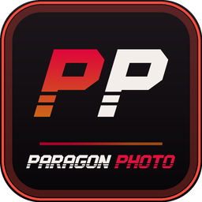

<p align="center">
  
</p>

<h1 align="center">Paragon Photo</h1>

<p align="center">
  <b>A native image editor in the Paragon family's look, for personal use.</b><br>
  Layers, masks, adjustment layers, layer styles, type, vectors, brushes and real PSD files.
</p>

Paragon Photo is a personal build of [PhotoCraft](https://github.com/storytold/photocraft), the
open-source, clean-room Photoshop-style editor written in Rust by the ArtCraft team and the
PhotoCraft contributors. It keeps PhotoCraft's editor and changes what you see: the name, the icon,
the links and the theme, with the web build left out.

## Build and run

You need Rust 1.95 or newer ([rustup](https://rustup.rs)). On Linux, also the usual GUI
development packages (see [`docs/development.md`](docs/development.md)).

```bash
cargo run --release -p photocraft
```

The binaries are `paragon-photo` (the app) and `paragon-photo-cli` (headless: convert, inspect,
batch, scripts, MCP). The Cargo packages keep their PhotoCraft names (`photocraft`,
`photocraft-cli`), which is why `-p photocraft` builds Paragon Photo.

```bash
cargo build --release -p photocraft -p photocraft-cli
```

Settings live in `~/.config/paragon-photo` on Linux, `~/Library/Application Support/ParagonPhoto` on
macOS and `%APPDATA%\ParagonPhoto` on Windows, separate from any PhotoCraft install.

## Windows installer

`.github/workflows/windows-installer.yml` builds a Windows installer (`.msi`, per-user by default,
for everyone optional) and a portable ZIP on a GitHub Windows runner:

- **To get one:** GitHub, Actions, **Windows installer**, **Run workflow**. When the run finishes,
  download `paragon-photo-windows-x64` from its Artifacts and run the `.msi`.
- **To publish a release:** bump `version` under `[workspace.package]` in `Cargo.toml`, commit,
  then push a matching tag (`git tag v0.24.0`, `git push origin v0.24.0`). The installer is attached
  to a GitHub Release, which the app's updater checks.

The installer is unsigned, so Windows SmartScreen warns the first time: **More info**, **Run anyway**.
It installs to `%LOCALAPPDATA%\Programs\Paragon\Paragon Photo` (or `Program Files\Paragon\...` for
everyone) and is its own product: it never replaces or removes a PhotoCraft install.

## What's in it

PhotoCraft's editor, unchanged: layers, masks, adjustment layers, layer styles, type, vectors, a
real brush engine, Camera Raw and real PSD files.

<h4>🧰 69 tools</h4>
Move · Artboard · Rectangular and Elliptical Marquee · Single Row Marquee · Single Column Marquee · Lasso · Polygonal Lasso · Magnetic Lasso · Object Selection · Quick Selection · Magic Wand · Crop · Perspective Crop · Slice · Slice Select · Frame · Eyedropper · Color Sampler · Ruler · Note · Count · Remove · Spot Healing Brush · Healing Brush · Patch · Content-Aware Move · Red Eye · Brush · Pencil · Mixer Brush · Color Replacement · Clone Stamp · Pattern Stamp · History Brush · Art History Brush · Eraser · Background Eraser · Magic Eraser · Gradient · Paint Bucket · Blur · Sharpen · Smudge · Dodge · Burn · Sponge · Pen · Freeform Pen · Curvature Pen · Add Anchor Point · Delete Anchor Point · Convert Point · Horizontal and Vertical Type · Horizontal and Vertical Type Mask · Path Selection · Direct Selection · Rectangle · Ellipse · Triangle · Polygon · Star · Line · Custom Shape · Hand · Rotate View · Zoom

`state::tests::readme_tool_list_matches_tool_all` checks this list against the app's tools.

## Automation and AI agents (MCP)

`paragon-photo-cli` can drive the editor from scripts, and it is an
[MCP](https://modelcontextprotocol.io) server, so an AI assistant can run real editor commands
(open, crop, adjust, export...) on files in folders you allow:

```bash
claude mcp add paragon-photo -- paragon-photo-cli mcp --headless --automation-read-root ~/Pictures --automation-write-root ~/Pictures/edited
```

Headless mode works on files only; it opens no network port. Bridge mode drives the open window
over a token-protected local connection. Details: [`docs/mcp.md`](docs/mcp.md),
[`docs/control-protocol.md`](docs/control-protocol.md). (Its environment variables keep their
upstream `PHOTOCRAFT_` prefix.)

## Keeping up with PhotoCraft

The fork keeps PhotoCraft's history, so its fixes merge in. Paragon Photo's changes are a
re-runnable script plus a few commits, and internal names (crates, modules, `PHOTOCRAFT_*`) are
unchanged so merges stay small:

```bash
git fetch upstream
```

```bash
git merge upstream/main
```

```bash
python3 scripts/paragon_rebrand.py
```

The script rebrands whatever the merge brought in (`--check` lists it without changing anything).
What it renames and what it keeps, and why, is at the top of
[`scripts/paragon_rebrand.py`](scripts/paragon_rebrand.py).

## The icon

Drawn from vector outlines in the style of the Paragon PR7 plugins' icon by
[`scripts/paragon_logo.py`](scripts/paragon_logo.py), which writes every size and format the app
needs. See [`assets/app-icon/README.md`](assets/app-icon/README.md).

## Licence

The code is PhotoCraft's, under the MIT License or the Apache License 2.0 at your option
([`LICENSE-MIT`](LICENSE-MIT), [`LICENSE-APACHE`](LICENSE-APACHE)); Paragon Photo's changes are
under the same terms. [`NOTICE`](NOTICE) keeps PhotoCraft's copyright and lists what changed, and
[`ATTRIBUTION.md`](ATTRIBUTION.md) credits every bundled asset. The Paragon Photo name and icon are
the repository owner's and not covered by the code licence. Paragon Photo does not use the ArtCraft
name or marks.

PhotoCraft's own documentation is kept in [`docs/`](docs/) and [`book/`](book/), rebranded where it
names the app; [`AGENTS.md`](AGENTS.md) is upstream's contributor guide.
